<p align="center">
  
</p>

<h3 align="center">홈페이지를 짓는 터 · 블록을 골라 붙이면 홈페이지가 돼요</h3>

<p align="center">
  
  
  
  
  
</p>

<p align="center">
  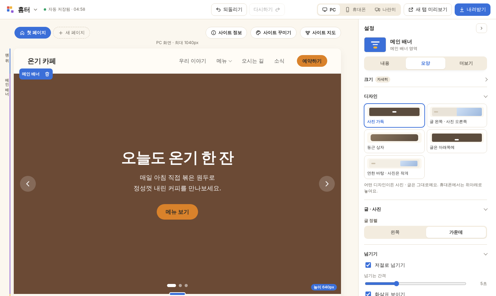
</p>

브라우저에서 바로 쓰는 **한국형 홈페이지 만들기 도구**예요.
견본으로 시작해 글 · 사진을 바꾸고, 다 만든 홈페이지는 압축파일로 내려받아 인터넷에 올려요.
가게 사장님이 휴대폰으로 직접 글 · 사진을 고칠 수 있는 **관리자 화면**도 함께 만들어 줘요.

> **이런 분께** — 작은 가게 · 병원 · 학원 · 회사 · 공공기관 · 개인 포트폴리오 홈페이지를 직접 만들고 싶은 분<br>
> **이런 점이 달라요** — 어려운 말 대신 쉬운 말 · 견본으로 시작 · 만든 뒤에도 사장님이 혼자 고쳐요

<details>
<summary><b>목차</b></summary>

1. [한눈에 보기](#1-한눈에-보기)
2. [시작하기](#2-시작하기)
3. [화면 둘러보기](#3-화면-둘러보기)
4. [할 수 있는 것](#4-할-수-있는-것)
5. [관리자 화면 (사장님용)](#5-관리자-화면-사장님용)
6. [인터넷에 올리기](#6-인터넷에-올리기-render)
7. [저장과 백업](#7-저장과-백업)
8. [알아두면 좋은 점](#8-알아두면-좋은-점)
9. [폴더 · 파일 구성](#9-폴더--파일-구성)
10. [개발자 메모](#10-개발자-메모)
11. [사용 허락](#11-사용-허락)

</details>

---

## 1. 한눈에 보기

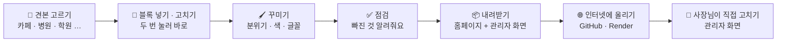

| 만드는 사람 (홈터) | 사장님 (관리자 화면) | 손님 (완성 홈페이지) |
| :-- | :-- | :-- |
| 블록 · 디자인 · 페이지를 만들어요 | 정해진 칸의 글 · 사진만 쉽게 고쳐요 | 빠르고 가벼운 홈페이지를 봐요 |
| PC 브라우저 | 휴대폰 · PC 브라우저 (앱처럼 설치) | 어떤 기기든 |

---

## 2. 시작하기

| 여는 방법 | 설명 |
| --- | --- |
| 💻 내 컴퓨터에서 | 폴더의 `index.html`을 두 번 눌러요. 크롬 · 엣지를 추천해요. |
| 🌐 인터넷 주소로 | Render 같은 곳에 올린 주소를 열어요 ([6. 인터넷에 올리기](#6-인터넷에-올리기-render)). |

<p align="center">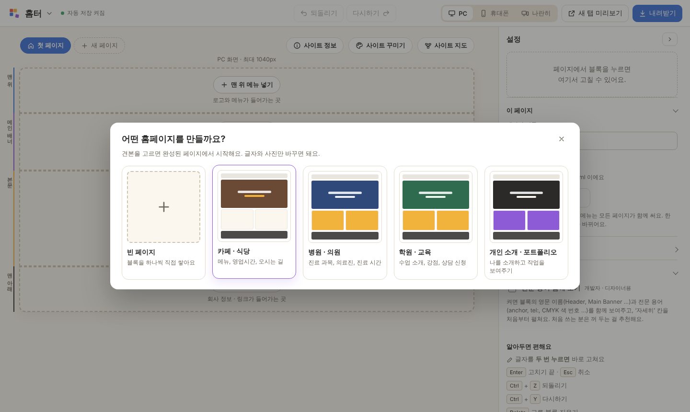</p>

1. 처음 열면 **견본 고르기**가 떠요. 카페 · 병원 · 학원 · 개인 소개 중에 고르거나 빈 페이지로 시작해요.
2. 짧은 **길잡이**가 화면을 네 군데 짚어 줘요 (견본 → 글 · 사진 바꾸기 → 색 고르기 → 내려받기).
3. 글자는 **두 번 눌러** 바로 고치고, 오른쪽 설정 칸에서 자세히 고쳐요.
4. 다 되면 오른쪽 위 **내려받기**. 점검을 거쳐 압축파일이 내려받아져요.

> PC 화면에서 쓰는 도구예요. 창 너비가 900px보다 좁으면 "PC에서 이용해주세요" 안내가 떠요.

---

## 3. 화면 둘러보기

| 자리 | 하는 일 |
| --- | --- |
| ⬆️ 위쪽 막대 | 로고 메뉴(파일 · 도움말), 되돌리기 · 다시하기, **PC · 휴대폰 · 나란히**, 새 탭 미리보기, 내려받기 |
| 🖥️ 가운데 | 홈페이지 모습 그대로 고치는 곳 — 맨 위 메뉴 · 메인 배너 · 본문 · 맨 아래 정보 |
| 🔖 가운데 위 | 페이지 탭, **사이트 정보**, **사이트 꾸미기**, **사이트 지도** |
| ➡️ 오른쪽 | 고른 블록의 설정 칸(내용 · 모양 · 더보기), 블록 넣기 칸 |

<table>
  <tr>
    <td width="50%">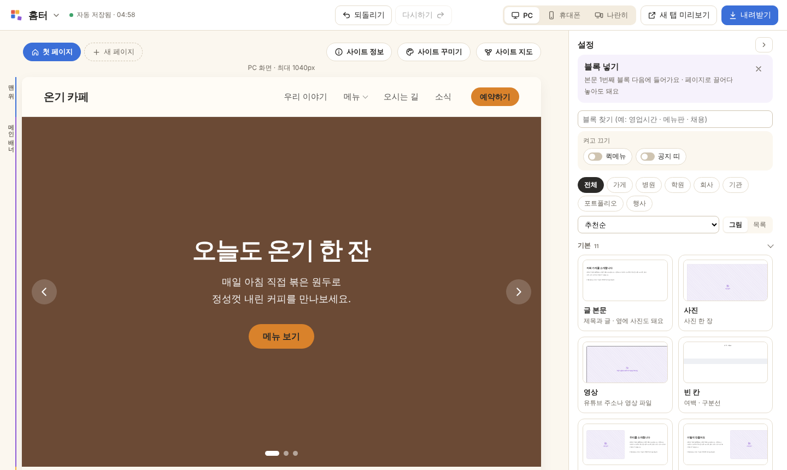</td>
    <td width="50%">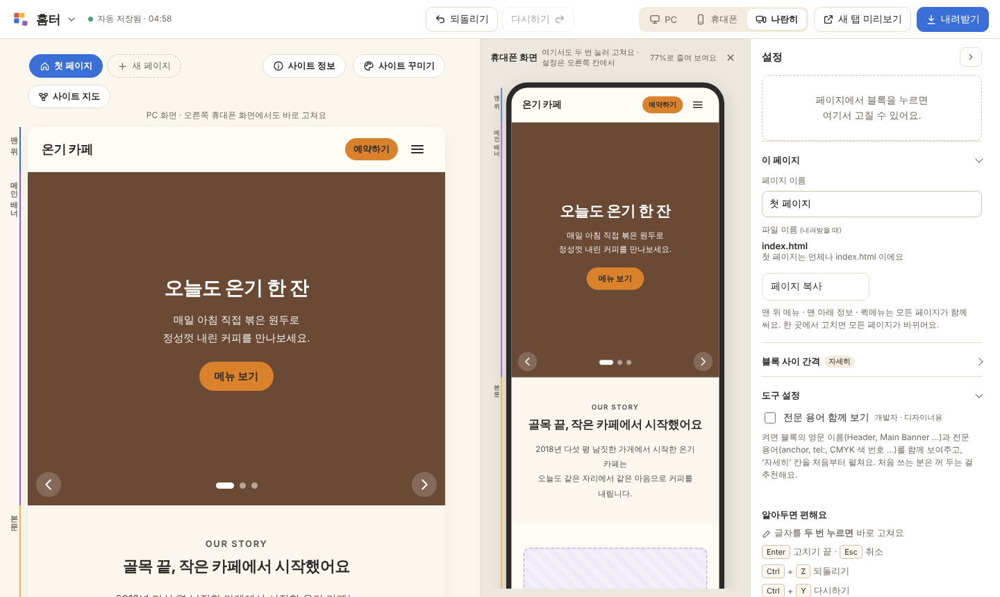</td>
  </tr>
  <tr>
    <td align="center"><b>블록 넣기</b> — 업종 · 정렬 · 즐겨찾기 · 그림/목록 보기</td>
    <td align="center"><b>나란히</b> — PC와 휴대폰을 같이 보며 어느 쪽에서든 고쳐요</td>
  </tr>
</table>

- **나란히**: 어느 쪽에서 고쳐도 다른 쪽이 바로 따라 바뀌고, 되돌리기는 순서대로 하나씩 돌아가요.
- **Tab 키**: 설정 칸에서 Tab을 누르면 다음 칸으로 넘어가요.

---

## 4. 할 수 있는 것

### 🧱 블록 견본 (54개)

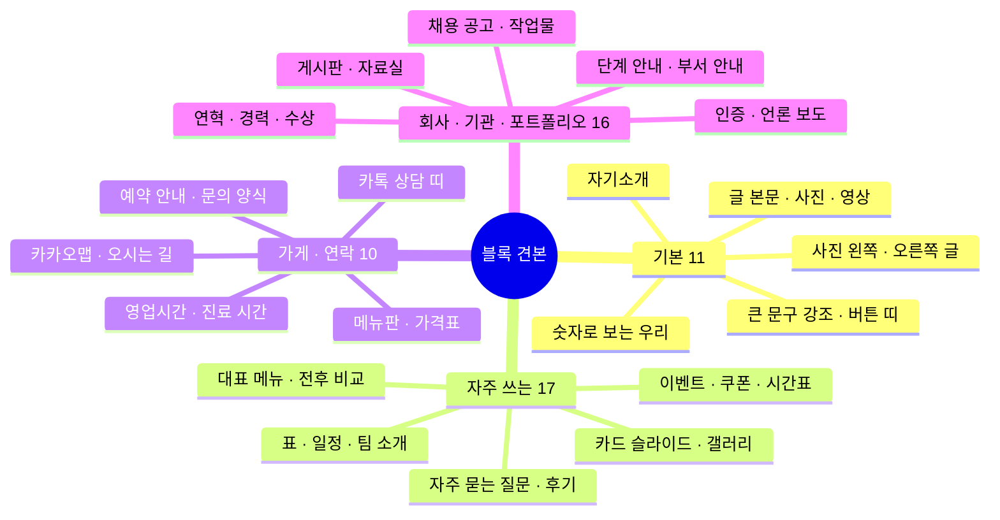

<details>
<summary><b>블록 견본 전체 목록 보기</b></summary>

| 묶음 | 블록 · 견본 |
| --- | --- |
| 기본 | 글 본문, 사진, 영상, 빈 칸, 사진 왼쪽 · 글, 글 · 사진 오른쪽, 큰 문구 강조, 버튼 띠, 숫자로 보는 우리, 자기소개, 사이드 칸 |
| 자주 쓰는 블록 | 카드 슬라이드, 갤러리, 자주 묻는 질문, 후기, 표, 일정, 팀 소개, 대표 메뉴 3가지, 하는 일 3가지, 전후 비교, 사진 두 장, 별점 후기 상자, 고객사 후기, 질문 상자, 수업 시간표, 이벤트 · 쿠폰, 담당자 안내 |
| 가게 · 연락 | 영업시간(지금 영업 중 저절로), 가격표, 메뉴판, 지도 · 오시는 길(카카오맵), 문의 · 예약 양식, 로그인 칸, 예약 안내, 주차 · 대중교통, 카톡 상담 띠, 진료 시간 |
| 회사 · 기관 · 포트폴리오 | 게시판 목록(새 글 N 표시), 자료 내려받기(PDF · 한글), 단계 안내, 부서 · 담당자 안내, 연혁 · 경력, 로고 · 인증 띠, 채용 공고(마감일 지나면 저절로 마감), 작업물 · 분류별 보기, 견적 문의, 회사 숫자 성과, 인증 · 특허, 언론 보도, 수상 내역, 이력서 받기, 민원실 운영 시간 |
| 페이지 틀 | 맨 위 메뉴, 메인 배너, 맨 아래 정보 — 페이지 가운데 빈 자리에서 넣고, 블록 막대의 휴지통으로 빼요 |
| 켜고 끄기 | 퀵메뉴(카톡 · 전화 · 맨 위로), 공지 띠(기간이 지나면 저절로 사라져요) |

</details>

### ✏️ 블록 넣기 · 고치기

| 기능 | 설명 |
| --- | --- |
| 블록 넣기 | 본문의 **+**, 줄 끝 빈자리의 **‘여기에 넣기’**, 또는 끌어다 놓기 |
| 찾기 · 업종 · 정렬 | 이름으로 찾기, 업종(가게 · 병원 · 학원 · 회사 · 기관 · 포트폴리오 · 행사), 추천순 · 자주 쓴 순 · 이름순, ★ 즐겨찾기 |
| 자리 맞추기 | 빈자리가 있으면 그 너비로 들어가요. 지우면 옆 블록이 넓어지고 사진은 높이를 지켜요 |
| 블록 바꾸기 ⇄ | 같은 자리 · 같은 너비로 다른 블록이 돼요. 제목 · 목록 글 · 사진은 옮겨 와요 |
| 고치기 | 두 번 눌러 고치기, 사진 넣기 · 위치 맞추기 · 자르기, 복사(Ctrl + D), 되돌리기(Ctrl + Z) |
| 크기 · 여백 | 12칸 너비 · 높이 손잡이, 위 · 아래 · **양옆 여백**, 휴대폰 모습 따로 맞추기 |
| 사진 비율 | 가로 / 세로 → 원래대로 · 와이드 · 16:9 · 4:3 · 1:1, **칸에 꽉 채우기** |
| 숨기기 · 품절 | 항목 · 블록 **잠시 숨기기**, 메뉴 **품절** — 지우지 않고 손님 화면에서만 감춰요 |

### 🖌️ 디자인

<p align="center">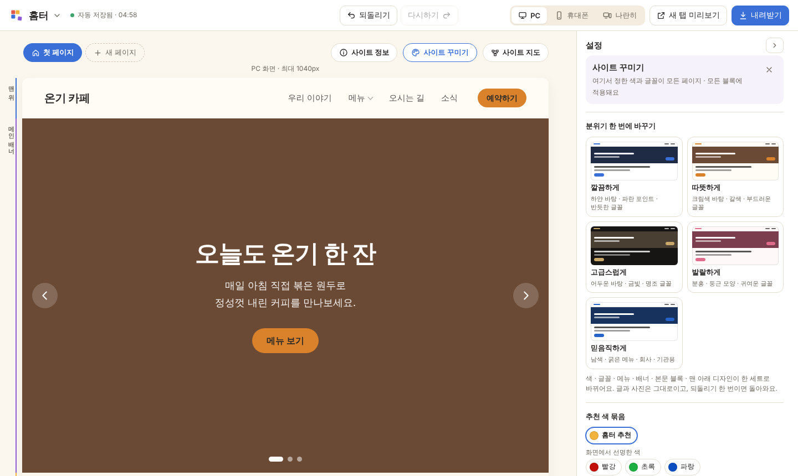</p>

| 무엇을 | 고를 수 있는 것 |
| --- | --- |
| **분위기 한 번에** | 깔끔하게 · 따뜻하게 · 고급스럽게 · 발랄하게 · 믿음직하게 — 색 · 글꼴 · 메뉴 · 배너 · 본문 · 맨 아래가 한 세트로 |
| 맨 위 메뉴 | 기본 · 아래 선 · 떠 있는 막대 · 메뉴 알약 · 굵은 밑줄 · 큰 글자 (6가지) |
| 메인 배너 | 사진 가득 · 글 왼쪽 사진 오른쪽 · 둥근 상자 · 글 아래쪽 · 연한 바탕 (5가지) |
| 맨 아래 정보 | 간단하게 · 가운데 · 자세하게 × 어둡게 · 밝게 · 연하게 · 포인트색 |
| 본문 블록 공통 | 기본 · 그림자 카드 · 연한 상자 · 위아래 선 · 어두운 바탕, 제목 가운데 / 왼쪽 |
| 모양 복사 | 모양 복사 · 붙이기 · **이 페이지 전체에** (글 · 사진은 그대로) |
| 색 | 추천 색 묶음, 색 조합 찾기, 사진에서 색 뽑기, HEX · RGB, 흐린 글자 알림 |
| 글꼴 | 한글 · 영문 · 제목 따로, **읽기 쉬운 글꼴**(프리텐다드 · 본고딕 · 나눔고딕), 내 글꼴, 글꼴 찾기(**눈누 · 산돌구름**) |

### 🏪 사이트 정보

- **가게 기본 정보** — 상호 · 대표 · 전화 · 주소 · 이메일 · 사업자등록번호 등. 한 번 고치면 홈페이지 전체의 같은 글이 바뀌어요.
- **상호 · 사이트 이름 같이 쓰기** — 이름 하나로 메뉴 제목 · 상호 · 맨 아래 이름 · 저작권 글이 함께 바뀌어요.
- 한 줄 소개, **카톡 공유 미리보기**와 점검, 공유 사진, 작은 아이콘, 홈페이지 주소, **QR 코드**, 글자 한 번에 바꾸기.

### 🗺️ 페이지 · 사이트 지도

- 여러 페이지 · 페이지 견본 (소개 · 메뉴 · 오시는 길 · 공지 · 자료실 · 민원 안내 · 연혁 · 작업물 · 채용 · 예약 · 개인정보 처리방침 · 이용약관 · 404 …)
- **여러 페이지 견본** — 가게 · 병원 · 학원 · 회사 · 관공서 · 포트폴리오 · 행사, 메뉴까지 이어진 채로 한 번에
- 사이트 지도: 페이지 카드와 연결선, 끌어서 잇기, 연결 안 된 페이지 표시, 스티커 메모

### ✅ 점검 · 내려받기

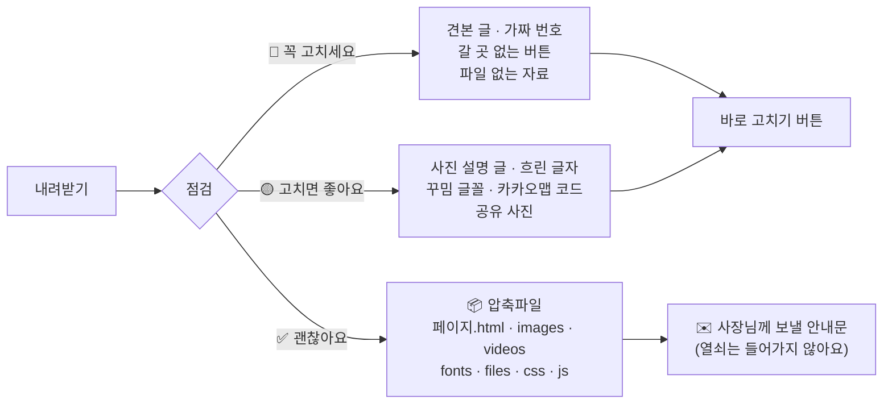

---

## 5. 관리자 화면 (사장님용)

<p align="center">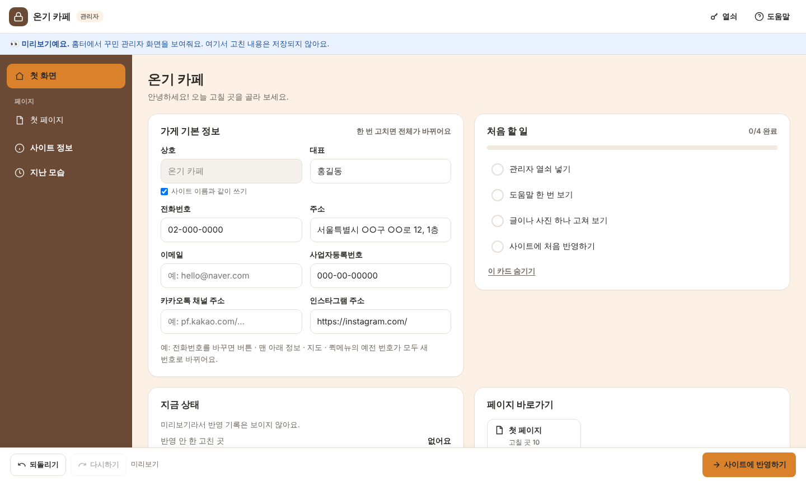</p>

내려받기 창에서 **관리자 화면도 받기**를 고르면, 사장님이 휴대폰 · 컴퓨터에서 직접 고칠 수 있는 화면이 함께 만들어져요.

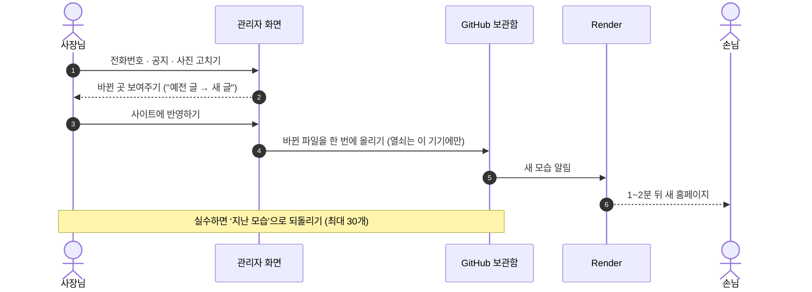

| 사장님이 할 수 있는 것 | 만드는 사람이 정하는 것 |
| --- | --- |
| 고칠 수 있는 칸의 글 · 사진 · 링크 | 디자인 · 배치 · 블록 순서 (그대로 지켜져요) |
| 가게 기본 정보, 공지 띠 날짜, 자료실 파일 | 관리자 화면 배치(왼쪽 메뉴 · 위쪽 탭 · 한 줄) |
| 항목 숨기기 · 품절, 블록 잠시 숨기기 | 첫 화면 카드 · 자주 고치는 곳 · 처음 할 일 |
| 카톡 공유 미리보기, QR 코드 | 사장님께 남기는 메모 |
| 지난 모습으로 되돌리기, 휴대폰 홈 화면에 추가 | ‘따라 하기 안내’로 보관함 연결 |

> 🔒 열쇠(GitHub 토큰)는 사장님 비밀번호로 잠가 **그 기기 브라우저에만** 보관해요. 밖으로 보내지 않아요.
> 자세한 연결 방법은 [`로그인_연결_안내.md`](로그인_연결_안내.md)와 홈터 안의 ‘따라 하기 안내’를 봐 주세요.

---

## 6. 인터넷에 올리기 (Render)

홈터 도구도, 내려받은 홈페이지도 **서버 없이 돌아가는 정적 사이트**예요. 폴더 그대로 올리면 돼요.

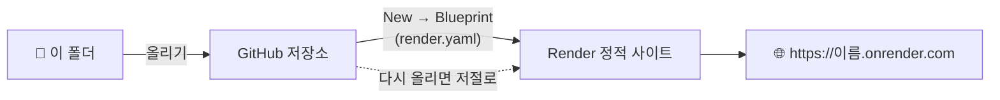

1. GitHub에 새 저장소를 만들고 폴더 안의 파일을 모두 올려요 (`index.html`이 맨 위에 있어야 해요).
2. [Render](https://render.com)에 GitHub로 로그인해요.
3. **New → Blueprint** 로 그 저장소를 고르면 `render.yaml` 대로 만들어져요.
   (또는 **New → Static Site** · Build Command 비움 · Publish Directory `./`)
4. 잠시 뒤 `https://이름.onrender.com` 같은 주소가 생겨요. 고친 파일을 다시 올리면 저절로 새로 올라가요.

---

## 7. 저장과 백업

| 방법 | 어디에 | 언제 쓰나요 |
| --- | --- | --- |
| 💾 자동 저장 | 이 컴퓨터의 이 브라우저 | 고칠 때마다 저절로. 브라우저 기록을 지우면 사라질 수 있어요 |
| 📄 작업 파일 (`.hometeo`) | 내 컴퓨터 파일 | 다른 컴퓨터에서 이어 하기 · 백업. 오래 안 받으면 홈터가 알려줘요 |
| ☁️ 보관함에서 불러오기 | GitHub 보관함 | 사장님이 관리자 화면에서 고친 최신 내용을 가져올 때 |

---

## 8. 알아두면 좋은 점

- **인터넷이 필요한 것** — 글꼴(구글 글꼴 · 프리텐다드), 유튜브 영상, 카카오맵, 바깥 사이트 버튼.
- **지도** — 카카오맵 → 가게 검색 → 공유 → **지도 퍼가기** → ‘HTML 태그 복사’로 받은 코드를 지도 블록에 붙여넣어요. 코드가 없으면 주소 카드가 보이고, 누르면 카카오맵이 열려요.
- **문의 양식 · 로그인** — 서버가 없어서 메일로 받기, 구글 · 네이버 폼 연결을 추천해요. 로그인 칸은 ‘모양만’ 있어요 ([`로그인_연결_안내.md`](로그인_연결_안내.md)).
- **미리보기 · 내려받은 홈페이지에서만 보이는 것** — 움직이는 지도, 유튜브 재생, 날짜에 따라 바뀌는 것(공지 띠 기간 · 영업 중 표시 · 채용 마감 · 새 글 N).

---

## 9. 폴더 · 파일 구성

```
hometeo/
├─ index.html              화면 뼈대 (스크립트를 차례대로 불러와요)
├─ css/style.css           도구 화면 모습
├─ js/
│  ├─ theme.js             사이트 색 · 글꼴 (색 계열 · 조합 · 대비 · 내 글꼴)
│  ├─ ui-kit.js            오른쪽 설정 칸 부품 (칸 · 고르기 · 사진 · 비율 · 링크 …)
│  ├─ blocks.js            블록 정의 · 블록 견본 · 분위기 · 영업시간 계산  ← 새 블록은 여기에
│  ├─ block-styles.js      블록의 실제 모습 (편집 · 미리보기 · 내려받기가 함께 써요)
│  ├─ templates.js         시작 견본
│  ├─ page-templates.js    페이지 견본 · 여러 페이지 견본
│  ├─ page-export.js       완성 홈페이지 HTML · 새 탭 미리보기 · 손님 화면 스크립트
│  ├─ site-build.js        완성 페이지 만들기 공통 (홈터 · 관리자 화면이 함께 써요)
│  ├─ admin-ui.js          관리자 화면 배치도 · 고칠 칸 목록 · 가게 기본 정보 · 바뀐 곳 찾기 · QR
│  ├─ admin-template.js    관리자 화면 묶음 만들기 (아이콘 · manifest 포함)
│  ├─ qrcode.js            QR 코드 (Kazuhiko Arase, MIT)
│  ├─ history.js           되돌리기 · 다시하기
│  ├─ storage.js           자동 저장 (IndexedDB)
│  ├─ zip.js               압축파일 만들기
│  └─ app/                 편집 화면 동작 (12개 파일, 순서대로 불러와요)
│     ├─ 01-core.js            상태 · 블록 목록 · 칸 채우기 · 바꾸기(되돌리기) · 넣기 · 지우기
│     ├─ 02-picker.js          블록 넣기 칸 (찾기 · 업종 · 정렬 · 즐겨찾기 · 켜고 끄기)
│     ├─ 03-theme-info.js      사이트 꾸미기 · 사이트 정보
│     ├─ 04-admin-guide.js     관리자 화면 꾸미기 · 따라 하기 안내
│     ├─ 05-side-by-side.js    PC와 휴대폰 편집기 나란히
│     ├─ 06-inspector.js       오른쪽 설정 칸 · 모양 복사 · 본문 블록 디자인
│     ├─ 07-pages-map.js       페이지 막대 · 페이지 견본 · 사이트 지도
│     ├─ 08-edit-media.js      글자 고치기 · 사진 · 영상 넣기 · 미리보기 · 사진 위치
│     ├─ 09-save-export.js     자동 저장 · 작업 파일 · 내려받기 · 점검
│     ├─ 10-start-guide.js     시작 견본 · 길잡이 · 사용 안내 · 파일 메뉴
│     ├─ 11-resize-drag.js     너비 · 높이 손잡이 · 끌어다 놓기
│     └─ 12-events-start.js    이벤트 연결 · 시작
├─ admin/                  관리자 화면 (index.html · admin.css · admin.js)
├─ assets/                 로고
├─ docs/images/            README 화면 그림
├─ render.yaml             Render 정적 사이트 설정
└─ 로그인_연결_안내.md       로그인 칸 연결 안내
```

---

## 10. 개발자 메모

<details>
<summary><b>스크립트가 이어지는 모습 (펼치기)</b></summary>

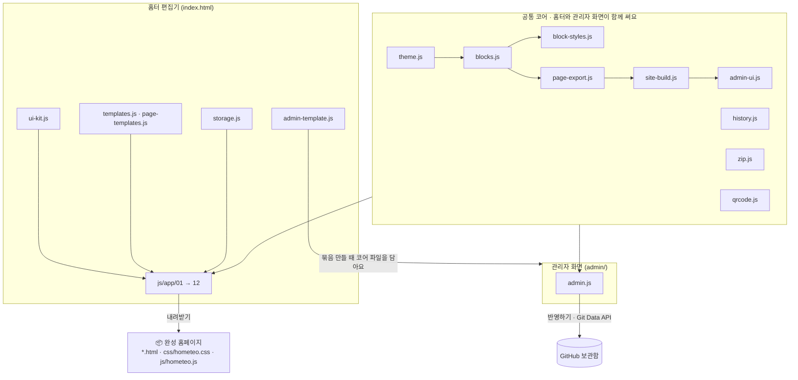

</details>

<details>
<summary><b>데이터 모양 (펼치기)</b></summary>

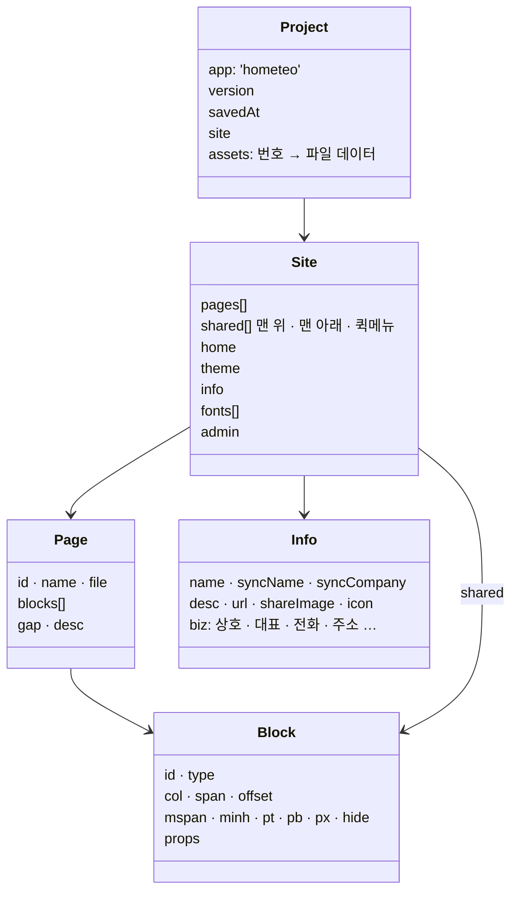

- 블록 `props`의 약속: `_off` 블록 잠시 숨기기, 목록 항목 `_hide` · `_sold`, 본문 공통 디자인 `skin` · `headAlign`, 사진 비율 `ratio`(`'fill'` = 칸에 꽉 채우기) · `ratioDir`
- ‘누르면 갈 곳’: `page:페이지번호` · `page:페이지번호#블록번호` · 전화번호 · `mailto:…` · `https://…`

</details>

**만드는 방식**
- 빌드 단계가 없어요. 순수 HTML · CSS · JS이고, `file://`로도 열려요.
- `js/app/` 파일들은 한 덩어리처럼 함께 움직여요. 맨 위 이름(`state`, `els`, `render`, `change` …)을 서로 쓰니 **index.html의 불러오는 순서를 바꾸지 마세요**.
- 다른 `js/` 파일은 각자 감싼 함수 안에서 `window.HOMETEO_*` · `window.Hometeo*`로만 내보내요.

**바꾸는 길**
- 블록이 바뀌는 일은 `change(label, fn)`, 사이트 전체는 `changeSite(label, fn)` — 되돌리기 기록 · 자동 저장 · 휴대폰 편집기 전달까지 해요.
- 그리기는 `window.HOMETEO_RENDER(def, props, helpers)` 를 거쳐요 (숨긴 항목 · 품절 · 본문 공통 디자인).

**새 블록 더하기** (`js/blocks.js`)
1. `BLOCKS`에 `{ name, en, zone, desc, thumb, content, lists, defaults, newItem, render, inspector }` 를 더해요.
   - `content` · `lists`: 관리자 화면에서 사장님이 고칠 수 있는 칸 규칙 (`items.*.title` 처럼 `*`)
2. `PRESETS`의 본문 목록에 견본을 더해요: `{ id, type, group: 'basic' | 'often' | 'shop' | 'org', tags: ['shop', …], name, desc, props }`
3. 모습은 `js/block-styles.js`에, 손님 화면에서 움직이는 것(날짜 · 고르기)은 `js/page-export.js`의 `SITE_SCRIPT`에.

**PC · 휴대폰 나란히**
- 휴대폰 칸은 같은 `index.html?pane=phone` 편집기예요. 메시지 `ht-load` · `ht-change` · `ht-select` · `ht-typing` · `ht-undo` · `ht-redo`로 이어지고, 되돌리기 · 자동 저장 · 설정 칸은 PC 쪽 하나만 써요.

**관리자 화면 (`admin/`)**
- GitHub 보관함의 `project.hometeo`를 불러와 `content` · `lists` 규칙의 칸만 보여줘요. 반영은 Git Data API(Blobs → Tree → Commit → Refs)로 한 번에, 반영 직전 최신 커밋을 대조해 다른 사람의 수정을 덮어쓰지 않아요.
- 열쇠는 PBKDF2 + AES-GCM으로 잠가 IndexedDB에만 보관해요.
- 홈터의 ‘관리자 화면 미리보기’는 `admin/index.html?preview=1`을 열고 `postMessage` · 자동 저장 · `BroadcastChannel('hometeo-live')`로 작업 내용을 받아요.

---

## 11. 사용 허락

- `js/qrcode.js` — QR Code Generator for JavaScript, © Kazuhiko Arase, MIT License. ("QR Code"는 DENSO WAVE의 등록 상표예요.)
- 목록의 글꼴은 무료로 상업적으로 쓸 수 있는 글꼴(SIL Open Font License 등)만 넣었어요. 내 글꼴 · 눈누 · 산돌구름에서 고른 글꼴은 글꼴마다 사용 범위를 꼭 확인하세요.
- README의 화면 그림은 견본 ‘온기 카페’로 만든 예시예요.
